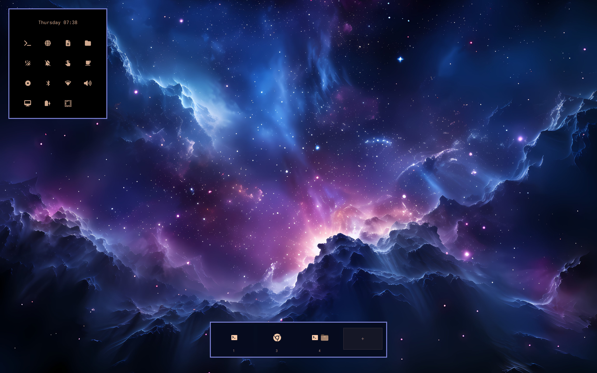

# 🔲 Nagual Strip

Floating workspace switcher with workspace cards, window list, settings, and smart app launcher.

**Nagual Strip** is a masked, click-through overlay for the bottom-center of your screen. It shows workspace cards, a right-click configuration popup, a smart MRU-ranked app grid, and an optional auto-hide trigger.



---

## Features

- **Workspace strip (bottom-center)** — Centered on the focused screen. Each card shows live app icons. A triangle under the active card points to it; hovering turns it into **×** to close all windows on that workspace.
- **Click workspace card** — Shows a mini menu listing all windows in that workspace. Click a window name to focus it (raises it if behind others), or right-click a window name to close it.
- **Click background (not icons)** — Right-click the empty strip background to open configuration. Configuration does not open when clicking workspace icons or buttons.
- **Auto-hide** — With `wsAutoHide: true`, the strip hides and reappears when hovering the bottom-center edge of the screen. This works standalone (no dependency on other plugins).
- **Pinned mode** — Set `wsToggleEnabled: false` to pin the strip on screen.
- **Instant switches** — `wsInstantSwitch` suppresses Hyprland animations when clicking workspace cards.
- **Smart app grid** — Leftmost launcher opens an MRU-ranked app grid (uses Omarchy app library). Click outside to dismiss.
- **Bottom reserve** — Writes `.nagualstrip-reserve` so maximized windows clear the strip.

## Installation

```sh
omarchy plugin add https://github.com/nagualcode/omarchy-nagualstrip.git --enable
omarchy restart shell
```

## Configuration

Settings live in `~/.config/omarchy/shell.json` under `plugins` entry `id: "nagualcode.nagualstrip"`:

```jsonc
{
  "id": "nagualcode.nagualstrip",
  "enabled": true,
  "animations": true,
  "wsScale": 1.0,
  "wsOpacity": 0.97,
  "wsStripGap": 21,
  "wsGap": 10,
  "wsAutoHide": true,
  "wsToggleEnabled": true,
  "wsInstantSwitch": true,
  "wsShowAppMenu": true,
  "wsShowOmafile": true,
  "wsShowNewWs": true,
  "wsStripRealIcons": true,
  "wsNeonEnabled": false,
  "appMenuRows": 1,
  "wsEdgeEnabled": false
}
```
